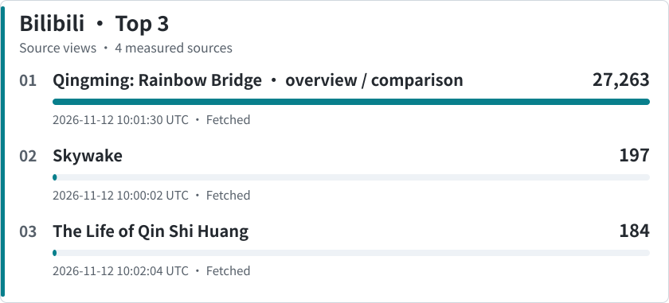
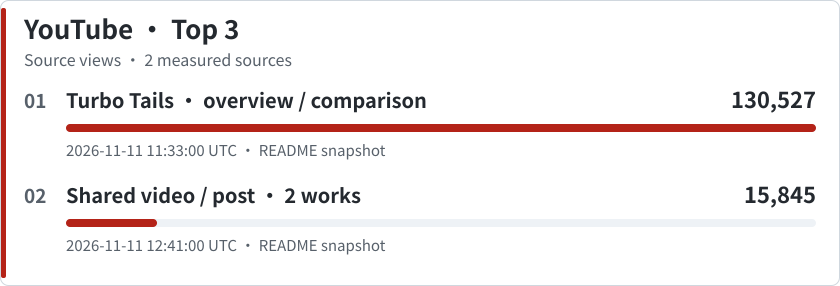

# Awesome Fable 5.2 3D Creations

English | [简体中文](README.zh-CN.md)

A collection of code-created 3D games, interactive worlds, films, and animations made with [Claude Fable 5.2](https://platform.claude.com/docs/en/models/fable-5-2/overview), with links to their creators and original work.

**Explore:** [Works](#browse-the-catalog) · [Code](#code-index) · [Resources](RESOURCES.md#english) · [3D assets](CODE-ASSETS.md#english) · [Making and maintaining](LIFECYCLE.md#english) · [Community](COMMUNITY-FEEDBACK.md#english)

<!-- rankings-preview:start -->
## Rankings at a glance

**143 works** · **65 with verified code** · **93 measured sources**

[Full popularity rankings](POPULARITY.md) · [Reader votes](COMMUNITY-RANKING.md) · [Ranking rules](RANKING-RULES.md)

### Platform popularity

Platforms rank independently by cumulative views or stars. Each shared source counts once. Dates belong to observations; cached values are not live. Missing data is not zero.

<picture>
  <source media="(max-width: 600px) and (prefers-color-scheme: dark)" srcset="assets/rankings/platforms-en-dark-mobile.svg">
  <source media="(max-width: 600px)" srcset="assets/rankings/platforms-en-light-mobile.svg">
  <source media="(prefers-color-scheme: dark)" srcset="assets/rankings/platforms-en-dark.svg">
  
</picture>

**X**

- **1.** [Saltline](<https://claude.ai/artifact/BGY1SztrAYcJQHSsnHHGmp>) — 4,228,304 views · [source](<https://x.com/felixrieseberg/status/2119925633564463609>)
- **2.** [Untitled open-world driving game](<https://x.com/mattshumer_/status/2120282133503820150>) — 3,206,564 views · [source](<https://x.com/mattshumer_/status/2120282133503820150>)
- **3.** [The Edge](<https://x.com/rileybrown/status/2119902109709537708>) — 853,458 views · [source](<https://x.com/rileybrown/status/2119902109709537708>)

[Full X ranking](<POPULARITY.md#x>)

**GitHub**

- **1.** [Portals](<https://portals-endless-worlds.netlify.app/>) — 132 stars · [source](<https://github.com/emollick/ai-portals>)
- **2.** [X-Ray Mirror](<https://github.com/MasterOfVFX2070/xray-mirror>) — 36 stars · [source](<https://github.com/MasterOfVFX2070/xray-mirror>)
- **2.** [Fable 5.2 FPS Reproduction](<https://wquguru.github.io/fable52-fps-repro/>) · [Rainy Dock Materials](<https://wquguru.github.io/fable52-fps-repro/demos/02-materials/>) · [Hard-Surface Modeling Studio](<https://wquguru.github.io/fable52-fps-repro/demos/03-models/>) — 36 stars · [source](<https://github.com/wquguru/fable52-fps-repro>)

[Full GitHub ranking](<POPULARITY.md#github>)

Bilibili and YouTube rankings

<picture>
  <source media="(max-width: 600px) and (prefers-color-scheme: dark)" srcset="assets/rankings/bilibili-en-dark-mobile.svg">
  <source media="(max-width: 600px)" srcset="assets/rankings/bilibili-en-light-mobile.svg">
  <source media="(prefers-color-scheme: dark)" srcset="assets/rankings/bilibili-en-dark.svg">
  
</picture>

- **1.** [Qingming: Rainbow Bridge](<https://www.aivi.fyi/games/qingming.html>) — 27,263 views · [source](<https://www.bilibili.com/video/BV1gsWg6gEis/>)
- **2.** [Skywake](<https://app.usecrayon.ai/play/992c2130-43da-416b-a577-aed9514d3057>) — 197 views · [source](<https://www.bilibili.com/video/BV17iWL6TE9w/>)
- **3.** [The Life of Qin Shi Huang](<https://www.bilibili.com/video/BV1ByWM6mE1D/>) — 184 views · [source](<https://www.bilibili.com/video/BV1ByWM6mE1D/>)

[Full Bilibili ranking](<POPULARITY.md#bilibili>)

<picture>
  <source media="(max-width: 600px) and (prefers-color-scheme: dark)" srcset="assets/rankings/youtube-en-dark-mobile.svg">
  <source media="(max-width: 600px)" srcset="assets/rankings/youtube-en-light-mobile.svg">
  <source media="(prefers-color-scheme: dark)" srcset="assets/rankings/youtube-en-dark.svg">
  
</picture>

- **1.** [Turbo Tails](<https://turbo-tails.vercel.app/>) — 130,527 views · [source](<https://www.youtube.com/watch?v=SsSKJA0EHD4>)
- **2.** [Zombie FPS: AK-47](<https://neurorich.ru/projects/claude-fable-5-2-proekty/>) · [Earth: Neuro Rich](<https://neurorich.ru/projects/claude-fable-5-2-proekty/>) — 15,845 views · [source](<https://www.youtube.com/watch?v=WREAJZnAA2k>)

[Full YouTube ranking](<POPULARITY.md#youtube>)

Up to three sources per platform; equal values share a rank, with stable ordering within ties. Overview and comparison-video views belong to the whole video.

### Reader choice

<picture>
  <source media="(max-width: 600px) and (prefers-color-scheme: dark)" srcset="assets/rankings/readers-en-dark-mobile.svg">
  <source media="(max-width: 600px)" srcset="assets/rankings/readers-en-light-mobile.svg">
  <source media="(prefers-color-scheme: dark)" srcset="assets/rankings/readers-en-dark.svg">
  
</picture>

[Full reader ranking](COMMUNITY-RANKING.md) · [Voting rules](RANKING-RULES.md)

Only works with at least one vote appear here. Add 👍 to a work's designated bot comment; removing it withdraws the vote. One account can support multiple works.
<!-- rankings-preview:end -->

[Run the local ranking and voting preview](LOCAL.md): `python3 scripts/local_app.py`

## Browse the catalog

- [Code index](#code-index)
- [Games](#games)
- [Interactive worlds and simulations](#interactive-worlds-and-simulations)
- [3D films and animations](#3d-films-and-animations)
- [Community feedback and discussion](#community-feedback-and-discussion) · [Feedback and trends](COMMUNITY-FEEDBACK.md#english)
- [Skills, tutorials, and creator advice](RESOURCES.md#english)
- [Search and verification log](SEARCH-LOG.md)

Creators' posts describe how they used Fable 5.2; some projects also use other models, tools, or existing assets. Preview images link to the corresponding creator post or project. **Watch** links lead to a creator's demo or trailer, and **Play** links lead to the shared game or experience. Availability may change. **Code** links are separate from demos. Repository links point to published project code; HTML and JavaScript links show the files delivered to the browser, which may depend on other files and may not be the full project. For an HTML page, use your browser’s “View Page Source” command. A dash means no code link was found; an unknown license means reuse terms were not confirmed.

Popularity figures are snapshots of the linked post, video, or repository, not the total reach of a project. Each platform is labeled with its last retrieval time in UTC. X counts are retrieved through [FxTwitter](https://github.com/FixTweet/FxTwitter) and Bilibili counts from its public video statistics; counts may lag. “Unavailable” means a metric could not be retrieved, not zero.

## Code index

As of 12 November 2026, **65 works** meet the verified-code criteria; **19 index entries** remain pending and **3** are outside the requested scope. Entries marked as unverified are retained as leads and do not count toward the verified-code target. The index also preserves entries awaiting further audit; it is not itself a verified total. See the [work-by-work audit](CODE-AUDIT.md) and [search and verification log](SEARCH-LOG.md).

| Work | Code | Type / license |
| --- | --- | --- |
| Graveyard Shift | [Repository](https://github.com/ethanplusai/zombies) | Project code · MIT |
| Yonkers Rises | [Delivered HTML](https://tools.simonwillison.net/yonkers-rises) | Browser code · License unknown |
| Blueline | [JavaScript build](https://playblueline.pages.dev/game.js) | Browser build · All rights reserved |
| Saltline | [Artifact](https://claude.ai/artifact/BGY1SztrAYcJQHSsnHHGmp) | Code visibility not verified · License unknown |
| Turbo Tails | [HTML](https://turbo-tails.vercel.app/) | Page source · License unknown |
| VELA BAY | [Repository](https://github.com/GitHub30/fable52-gta6) | Project code · License not specified |
| Evensong | [HTML](https://evensong-phi.vercel.app/) · [JS entry](https://evensong-phi.vercel.app/src/main.js) | Browser code · License unknown |
| I Would Have Gotten Away With It | [HTML](https://i-would-have-gotten-away-with-it.netlify.app/) · [JS bundle](https://i-would-have-gotten-away-with-it.netlify.app/assets/index-C_8V-4tu.js) | Browser build · License unknown |
| Gilt & Gutter | [HTML](https://gilt-and-gutter.vercel.app/) · [JS entry](https://gilt-and-gutter.vercel.app/src/main.js) | Browser code · License unknown |
| Saltfire | [Download HTML](https://d2ol7oe51mr4n9.cloudfront.net/user_3GXbZB0UVQ4VNLix2xrfj28xkQu/096b9953-ca50-4858-80f0-3b7d427d1897.html) | HTML build · License unknown |
| What the Water Keeps | [HTML](https://what-the-water-keeps.vercel.app/) · [JS entry](https://what-the-water-keeps.vercel.app/src/main.js) | Browser code · License unknown |
| Portals | [Repository](https://github.com/emollick/ai-portals) | Project code · CC BY-NC-SA 4.0 |
| Jerusalem at Passover | [HTML](https://fable-jerusalem.vercel.app/) · [JS entry](https://fable-jerusalem.vercel.app/js/main.js) | Browser code · License unknown |
| Dino Jungle Survival 3D | [HTML](https://html-classic.itch.zone/html/20412026/index.html?v=1794293623) | Browser HTML with external dependencies · License unknown |
| Matrix | [Repository](https://github.com/tornikegomareli/Matrix) | Project code · License unknown |
| Stonehenge Solstice | [Repository](https://github.com/MeltTheManual/stonehenge-solstice) · [HTML](https://raw.githubusercontent.com/MeltTheManual/stonehenge-solstice/main/index.html) | Single-file project · MIT |
| Qingming: Rainbow Bridge | [HTML](https://www.aivi.fyi/games/qingming.html) | Browser HTML · License unknown · Model attribution not independently confirmed |
| Cabinet of Impossible Minerals | [HTML source](https://github.com/MiaAI-Lab/Claude-Fable-5.2-HTML-Files/blob/369dae7fe4102988676f07f147c4bbaefee3ff3a/008-cabinet-of-impossible-minerals.html) | HTML study · License unknown · Verification pending; excluded from verified count |
| Side A: A Turntable in CSS | [HTML source](https://github.com/MiaAI-Lab/Claude-Fable-5.2-HTML-Files/blob/369dae7fe4102988676f07f147c4bbaefee3ff3a/023-walnut-turntable.html) | HTML study · License unknown · Verification pending; excluded from verified count |
| A Cabinet of Computed Shells | [HTML source](https://github.com/MiaAI-Lab/Claude-Fable-5.2-HTML-Files/blob/369dae7fe4102988676f07f147c4bbaefee3ff3a/049-conchology-cabinet.html) | HTML study · License unknown · Verification pending; excluded from verified count |
| BÉTON BRUT | [HTML source](https://github.com/MiaAI-Lab/Claude-Fable-5.2-HTML-Files/blob/369dae7fe4102988676f07f147c4bbaefee3ff3a/052-beton-brut-zine.html) | HTML study · License unknown · Verification pending; excluded from verified count |
| The Combination | [HTML source](https://github.com/MiaAI-Lab/Claude-Fable-5.2-HTML-Files/blob/369dae7fe4102988676f07f147c4bbaefee3ff3a/056-the-combination.html) | HTML study · License unknown · Verification pending; excluded from verified count |
| The Comet Diner, 3 A.M. | [HTML source](https://github.com/MiaAI-Lab/Claude-Fable-5.2-HTML-Files/blob/369dae7fe4102988676f07f147c4bbaefee3ff3a/066-night-diner.html) | HTML study · License unknown · Verification pending; excluded from verified count |
| Strange Attractors | [HTML source](https://github.com/MiaAI-Lab/Claude-Fable-5.2-HTML-Files/blob/369dae7fe4102988676f07f147c4bbaefee3ff3a/069-strange-attractors.html) | HTML study · License unknown · Verification pending; excluded from verified count |
| Dustfall | [Repository](https://github.com/webKing021/dustfall) | Project code · License unknown |
| Cyberpunk Tokyo Motorcycle | [JavaScript build](https://amanndev.com/_next/static/chunks/2gdq495c_bsx_.js) | Browser build · License unknown · Verification pending; excluded from verified count |
| Earth: The Whole Story | [Repository](https://github.com/arpitpatel25/earth-whole-story) | Project code · License unknown |
| Soccer 3D | [Repository](https://github.com/ShaunPrice/soccer-3d) | Project code · License unknown |
| Emberfall Forge | [Repository](https://github.com/NineTigers/emberfall-forge-claude-fable-5.2) | Project code · MIT |
| Boeing 787-9 | [Repository](https://github.com/xiaozhenliu/boeing-fable-5-2) | Project code · License unknown · Model attribution not independently confirmed |
| Fable 5.2 Flight Simulator | [Repository](https://github.com/Para-FR/claude-fable-5.2-flight-sim) | Project code · License unknown |
| Spectra | [Repository](https://github.com/Seawolf0/Spectra) | Project code · License unknown |
| CEBA | [Repository](https://github.com/gavilanbe/ceba) | Project code · License unknown |
| Atelier Vesper: Heure Bleue 38 | [HTML source](https://github.com/MiaAI-Lab/Claude-Fable-5.2-HTML-Files/blob/369dae7fe4102988676f07f147c4bbaefee3ff3a/047-atelier-vesper-watch.html) | HTML study · License unknown · Verification pending; excluded from verified count |
| The Astrolabe | [HTML source](https://github.com/MiaAI-Lab/Claude-Fable-5.2-HTML-Files/blob/369dae7fe4102988676f07f147c4bbaefee3ff3a/063-the-astrolabe.html) | HTML study · License unknown · Verification pending; excluded from verified count |
| Tidebell | [Project code](https://github.com/hahaliu1029/fable5.2demo/tree/main/tidebell) | Project code · Apache-2.0 |
| Qingyun Sword Flight | [Project code](https://github.com/hahaliu1029/fable5.2demo/tree/main/game) | Project code · Apache-2.0 |
| MOTHLIGHT: Vesper-9 | [Project code](https://github.com/hahaliu1029/fable5.2demo/tree/main/mothlight) | Project code · Apache-2.0 |
| Kekenon: Cotonou | [Project code](https://github.com/Akotch/kekenon-cotonou) | Project code · License unknown |
| Indy’s Adventure 3D: Näsinneula | [Project code](https://github.com/ohylli/indys-adventure-3d) | Project code · License unknown |
| Neon Night Racer: Fable build | [Project code](https://github.com/KostiKoNeuro/gemini-carbon-vs-fable-5-2/tree/main/1-race/fable) | Project code · License unknown · Verification pending; excluded from verified count |
| Night Market: Fable build | [Project code](https://github.com/KostiKoNeuro/gemini-carbon-vs-fable-5-2/tree/main/2-diorama/fable) | Project code · License unknown |
| Boring Game | [Project code](https://github.com/jakozaur/sf_bay_area_transit_fable_5_2_game/tree/main/apps/game) | Project code · License unknown · Verification pending; excluded from verified count |
| Pinscreen | [HTML source](https://github.com/MiaAI-Lab/Claude-Fable-5.2-HTML-Files/blob/369dae7fe4102988676f07f147c4bbaefee3ff3a/051-pinscreen.html) | HTML study · License unknown · Verification pending; excluded from verified count |
| Par Avion: The Journey of One Letter | [HTML source](https://github.com/MiaAI-Lab/Claude-Fable-5.2-HTML-Files/blob/369dae7fe4102988676f07f147c4bbaefee3ff3a/064-par-avion.html) | HTML study · License unknown · Verification pending; excluded from verified count |
| Earth: Neuro Rich | [Download ZIP](https://neurorich.ru/files/claude-fable-5-2-proekty.zip) (`Earth/index.html`) | HTML project · License unknown |
| Zombie FPS: AK-47 | [Download ZIP](https://neurorich.ru/files/claude-fable-5-2-proekty.zip) (`Shooter/fps.html`) | HTML project · License unknown |
| Blameless | [Project code](https://github.com/Petyok/blameless) | Project code · MIT |
| Three Writing Desks | [Project code](https://github.com/az9713/fable-5.2-typewriter-demos) | Project code · License unknown |
| Custom Suit Studio | [Project code](https://github.com/KooEmmanuel/custom-suit-studio) | Project code · Apache-2.0 |
| ShuttleStrike | [Project code](https://github.com/fedifianto/shuttlestrike) | Project code · License unknown |
| Oriel 38 | [Project code](https://github.com/akashmakesdesigns/fable-sites/tree/main/sites/04-oriel) | Project code · License unknown |
| Tacta 75 | [Project code](https://github.com/akashmakesdesigns/fable-sites/tree/main/sites/05-tacta) | Project code · License unknown |
| Paper Dusk | [HTML artifact](https://evals.ag/api/v1/media/assets/ast_2QF9TYAX7FEA4H8Y3Y838M8ZA3/content) | Single-file HTML · License unknown |
| Tria Prima | [Repository](https://github.com/winchxyz/tria-prima) | Project code · MIT |
| Null Horizon | [Repository](https://github.com/dantecomedia/null-horizon) | Project code · License unknown |
| IRONDUSK — Yard 7 | [HTML](https://qiaomu.t5t6.com/irondusk-yard-7/) | Single-page browser code · License unknown |
| 霓虹对撞 3D 打砖块 | [HTML](https://qiaomu.t5t6.com/3d/) | Single-page browser code · License unknown |
| Skyflare | [JavaScript build](https://skyflare-game.vercel.app/assets/index-DI975xOs.js) | Browser build · License unknown |
| Snow Globe | [HTML artifact](https://evals.ag/api/v1/media/assets/ast_4FK7HPGSDT7WEGHDGDWXZ0738W/content) | Single-file HTML · License unknown |
| Sands of the Black Sun | [HTML artifact](https://evals.ag/api/v1/media/assets/ast_01K0N55YXGZGDV24CGYHFWPR7P/content) | Single-file HTML · License unknown |
| Apartment Walkthrough | [HTML artifact](https://evals.ag/api/v1/media/assets/ast_68MAV57X8V3Z6Y6605HZ755NN7/content) | Single-file HTML · License unknown |
| Golden Gate Bridge 3D | [HTML artifact](https://evals.ag/api/v1/media/assets/ast_6YQT3XG14P12EYXJPWY7PG68V0/content) | Single-file HTML · License unknown |
| Worm Rider | [Repository](https://github.com/amirmushichge/worm-rider) | Project code · MIT |
| SPIREFALL: Assault on the Terraforming Spire | [HTML artifact](https://evals.ag/api/v1/media/assets/ast_7G3X8N7GY5TX46BAE1H7HBFW99/content) | Single-file HTML · License unknown |
| LAST LIGHT: Dockside Refinery | [HTML artifact](https://evals.ag/api/v1/media/assets/ast_1AZW7W4223G2KWGJVR9WF54K3F/content) | Single-file HTML · License unknown |
| IRON TIDE: Terminal 7 | [HTML artifact](https://evals.ag/api/v1/media/assets/ast_0JAMNBYNJNTMAM502JBG09HY48/content) | Single-file HTML · License unknown |
| Fable 5.2 FPS Reproduction | [HTML source](https://github.com/wquguru/fable52-fps-repro/blob/main/demos/04-fps/index.html) | Project code · MIT |
| Rainy Dock Materials | [HTML source](https://github.com/wquguru/fable52-fps-repro/blob/main/demos/02-materials/index.html) | Project code · MIT |
| Hard-Surface Modeling Studio | [HTML source](https://github.com/wquguru/fable52-fps-repro/blob/main/demos/03-models/index.html) | Project code · MIT |
| X-Ray Mirror | [Repository](https://github.com/MasterOfVFX2070/xray-mirror) | Project code · License unknown |
| Impossible Spaces | [Core source](https://git.patch.gg/blendi/impossible-spaces/raw/a9db30c95ad7bf7805848c85c362d9ecf0c9133a/src/lib/portals.ts) · [Git repository](https://git.patch.gg/blendi/impossible-spaces.git) | Project code · MIT |
| Starry Nightrider | [HTML](https://starrynightrider.com/) · [JS bundle](https://starrynightrider.com/assets/index-CXqZzAc4.js) | Browser build · License unknown |
| LANTERNFALL | [Repository](https://github.com/loktar00/lanternfall) | Project code · License unknown |
| FEED | [HTML](https://feed-backrooms.vercel.app/) · [JS bundle](https://feed-backrooms.vercel.app/assets/index-DSUyeUO8.js) | Browser build · License unknown |
| Rug Racers | [HTML](https://noclipepe.pages.dev/rug/) · [JS bundle](https://noclipepe.pages.dev/rug/assets/index-Ebi07fPK.js) | Browser build · License unknown |
| SUBLEVEL 03 | [HTML](https://fps-fable52-7d7eb4.surge.sh/) | Single-file HTML · License unknown |
| Aiden's Revenge | [HTML](https://aidens-revenge.pages.dev/) · [JS bundle](https://aidens-revenge.pages.dev/assets/index-BDFYTUdJ.js) | Browser build · License unknown · Outside verified 3D/interactive-video scope (side-scrolling game) |
| Hundred Ghosts | [Repository](https://github.com/koumpas/hundred-ghosts) | Project code · License unknown · Outside verified 3D/interactive-video scope (2D) |
| Aquila | [HTML source](https://github.com/GavinLOrio/Fable-5.2-random-game/blob/55838a1f7565dc713edb3f985187338368fe6a81/rome/index.html) | Project code · License unknown · Verification pending; excluded from verified count |
| Dawnward | [HTML source](https://github.com/GavinLOrio/Fable-5.2-random-game/blob/6051b625701c68e9fcef4bef30f2476f287830e5/index.html) | Project code · License unknown · Verification pending; excluded from verified count |
| ringfall | [Git repository](https://git.patch.gg/rehan/ringfall.git) | Project code · License unknown |
| Rome, AD 320 | [HTML](https://fable-rome.surge.sh/) · [JavaScript entry](https://fable-rome.surge.sh/src/main.js) | Browser build · License unknown |
| Ant Playground | [Repository](https://github.com/ToonTalk/ant-playground) | Project code · MIT · Outside verified 3D/interactive-video scope (2D) |
| Oil paint | [Git repository](https://git.patch.gg/blendi/oil-paint.git) | Project code · MIT |
| Karakoram Highway | [HTML](https://karakoram-highway.vercel.app/) | Single-file HTML · License unknown |
| Siege Wing | [Delivered HTML](https://html-classic.itch.zone/html/20442416/index.html?v=1794407879) | Browser code · License unknown |

## Games

| Work | Creator | Description | Watch / play | Code | Popularity (last checked, UTC) |
| --- | --- | --- | --- | --- | --- |
| **Graveyard Shift** | Ethan (u/Rare_Guide_9830) | A round-based Three.js zombie survival shooter. The creator credits Fable 5.2, with Sonnet 5.5 and Opus 5.5 used for subprocesses. | [Play](https://zombies.ethanplus.ai/) · [Creator’s post](https://www.reddit.com/r/threejs/comments/1xtvxx0/i_asked_claude_fable_52_to_make_a_cod_zombies/) | [Repository](https://github.com/ethanplusai/zombies) Project code · MIT | — |
| **Siege Wing**  | bannerfall | A 3D helicopter combat game against a medieval army; the creator credits Fable 5.2 for software development and 3D modeling. | [Play and creator’s description](https://bannerfall.itch.io/siege-wing) | [Delivered HTML](https://html-classic.itch.zone/html/20442416/index.html?v=1794407879) Browser code · License unknown | Itch.io: metrics not verified 2026-11-11 18:06 UTC |
| **Saltline**  | Felix Rieseberg | A first-person shooter set in a rainy container port. | [Play](https://claude.ai/artifact/BGY1SztrAYcJQHSsnHHGmp) · [Creator's post](https://x.com/felixrieseberg/status/2119925633564463609) | [Artifact](https://claude.ai/artifact/BGY1SztrAYcJQHSsnHHGmp) Code visibility not verified · License unknown | X: 3,769,689 views, 13,107 likes, 960 reposts, 750 replies 2026-11-11 11:32 UTC |
| **Turbo Tails**  | Peter Yang | A browser kart racer with drifting, items, and single- and multiplayer modes. | [Play](https://turbo-tails.vercel.app/) · [Creator's post](https://x.com/petergyang/status/2119901658394358005) · [YouTube](https://youtu.be/SsSKJA0EHD4) | [HTML](https://turbo-tails.vercel.app/) Page source · License unknown | X: 31,415 views, 136 likes, 3 reposts, 24 replies 2026-11-11 11:32 UTC YouTube comparison video: 130,527 views 2026-11-11 11:33 UTC |
| **VELA BAY**  | 7mpy / GitHub30 | An Osaka-inspired open-world driving and action sandbox built in stages with Fable 5.2. | [Play](https://github30.github.io/fable52-gta6/) · [Creator's article](https://qiita.com/7mpy/items/5710fef43ba0e59204c6) | [Repository](https://github.com/GitHub30/fable52-gta6) Project code · License not specified | GitHub: 0 stars, 0 forks 2026-11-11 11:33 UTC |
| **Evensong**  | Kevin Ngo | A dark-fantasy boss fight in a drowned cathedral. The creator also used Tripo for character models. | [Play](https://evensong-phi.vercel.app/) · [Creator's post](https://x.com/kevin_t_ngo/status/2120238844754923874) | [HTML](https://evensong-phi.vercel.app/) · [JS entry](https://evensong-phi.vercel.app/src/main.js) Browser code · License unknown | X: 89,432 views, 1,318 likes, 81 reposts, 109 replies 2026-11-11 11:32 UTC |
| **I Would Have Gotten Away With It**  | Ethan Mollick | A reverse mystery-cartoon parody: scare visitors away before the sleuths unmask you. | [Play](https://i-would-have-gotten-away-with-it.netlify.app/) · [Creator's post](https://x.com/emollick/status/2119876449494540554) | [HTML](https://i-would-have-gotten-away-with-it.netlify.app/) · [JS bundle](https://i-would-have-gotten-away-with-it.netlify.app/assets/index-C_8V-4tu.js) Browser build · License unknown | X: 31,572 views, 503 likes, 32 reposts, 55 replies 2026-11-11 11:32 UTC |
| **Hogwarts Royale**  | Matt Shumer | A battle royale inspired by Harry Potter and Fortnite. | [Play](https://www.spawn.co/@mattshumer/hogwarts-royale) · [Creator's post](https://x.com/mattshumer_/status/2119872098306810226) | — | X: 168,109 views, 304 likes, 14 reposts, 15 replies 2026-11-11 11:32 UTC |
| **Blueline**  | Alex St Louis | A browser ice-hockey game; the creator used Fable 5.2 to improve an existing game and add features. | [Play](https://playblueline.pages.dev/) · [Creator’s post](https://x.com/AlexStLouis10/status/2120024471100907802) | [JavaScript build](https://playblueline.pages.dev/game.js) Browser build · All rights reserved | X: 43,294 views, 195 likes, 11 reposts, 23 replies 2026-11-11 11:32 UTC |
| **Vibes vs Luddites**  | alightinastorm | A Three.js basketball game with animated players in an arena. | [Watch](https://x.com/alightinastorm/status/2120010936584945922) | — | X: 55,512 views, 682 likes, 28 reposts, 64 replies 2026-11-11 11:32 UTC |
| **Desert-town FPS**  | alightinastorm | A browser shooter with an armory and a desert-town map. | [Play](https://www.spawn.co/@robot/frontline-warfare-deathmatch) · [Creator’s video](https://x.com/alightinastorm/status/2120020469487440210) · [Creator’s play link](https://x.com/alightinastorm/status/2120020477070766334) | — | X video: 11,702 views, 163 likes, 10 reposts, 20 replies 2026-11-11 12:04 UTC |
| **Miami-style crime game**  | @ericmaskfr | A third-person city game with driving, police chases, and missions; the creator shared the prompt. | [Watch](https://x.com/ericmaskfr/status/2119910195325481026) | — | X: 182,726 views, 978 likes, 71 reposts, 133 replies 2026-11-11 11:32 UTC |
| **Toy-room adventure**  | itssotsot | A Three.js third-person game exploring a toy-sized view of a room. | [Watch](https://x.com/itssotsot/status/2119909017216491720) | — | X: 339 views, 5 likes, 0 reposts, 0 replies 2026-11-11 11:32 UTC |
| **Floating-island FPS**  | Jarrod Watts | A shooter demo set among grassy islands and floating ruins. | [Watch](https://x.com/jarrodwatts/status/2120030097004777937) | — | X: 10,722 views, 154 likes, 2 reposts, 24 replies 2026-11-11 11:32 UTC |
| **Arena FPS with Portals**  | Sholto Douglas | A portal-equipped arena shooter, playtested by the creator and colleagues. | [Watch](https://x.com/_sholtodouglas/status/2119935331499925557) | — | X: 174,308 views, 1,920 likes, 91 reposts, 122 replies 2026-11-11 11:32 UTC |
| **Gears of War-style shooter**  | Matthew Berman | A third-person shooter made with Fable directing Unreal Engine. | [Watch](https://x.com/MatthewBerman/status/2119868629491789992) | — | X: 13,386 views, 132 likes, 7 reposts, 4 replies 2026-11-11 11:32 UTC |
| **Space-station shooter**  | Higgsfield | A sci-fi shooter built using Fable 5.2, Blender, Unreal Engine 5, and Higgsfield tools. | [Watch](https://x.com/higgsfield_ai/status/2119897113534529605) | — | X: 42,906 views, 567 likes, 35 reposts, 22 replies 2026-11-11 11:32 UTC |
| **Skywake**  | usecrayonai | A flight adventure made with Fable 5.2, Opus 5.5, Crayon, and Three.js. | [Play page](https://app.usecrayon.ai/play/992c2130-43da-416b-a577-aed9514d3057) · [Bilibili showcase](https://www.bilibili.com/video/BV17iWL6TE9w/) | — | Bilibili: 152 views, 1 like, 2 comments 2026-11-11 11:35 UTC |
| **Metal Slug in 3D**  | 阿达的AI思辩 | A Godot 3D game prototype inspired by Metal Slug, shown in the creator’s Fable 5.2 overview. | [Watch](https://www.bilibili.com/video/BV1yJW168ENZ/) | — | Bilibili overview: 41 views, 1 like, 1 comments 2026-11-11 11:35 UTC |
| **Saltfire**  | Higgsfield | A Three.js speedboat racer with waves, rockets, and AI opponents; boat assets use Higgsfield tools. | [Play](https://saltfire.higgsfield.app/) · [Creator’s post](https://x.com/higgsfield_ai/status/2119928918035910668) | [Download HTML](https://d2ol7oe51mr4n9.cloudfront.net/user_3GXbZB0UVQ4VNLix2xrfj28xkQu/096b9953-ca50-4858-80f0-3b7d427d1897.html) HTML build · License unknown | X: 25,667 views, 279 likes, 18 reposts, 4 replies 2026-11-11 11:35 UTC |
| **Rooftop Rally**  | Chong-U | A pickleball game made with Fable 5.2 and Unreal Engine; characters use Tripo. | [Play](https://wavedash.com/games/rooftop-rally) · [Creator’s post](https://x.com/chongdashu/status/2120154573356793883) | — | X: 66,175 views, 887 likes, 58 reposts, 67 replies 2026-11-11 11:35 UTC |
| **Paper Skies**  | Gamejam | A Three.js paper-plane game created from the same prompt as a Fable 5.1 comparison. | [Watch](https://x.com/ShipOnGamejam/status/2120184709732823356) | — | X: 337 views, 4 likes, 0 reposts, 4 replies 2026-11-11 11:35 UTC |
| **Gilt & Gutter**  | Kevin Ngo | A browser first-person duel with two characters and color-based shooting mechanics. | [Play](https://gilt-and-gutter.vercel.app/) · [Creator’s post](https://x.com/kevin_t_ngo/status/2119900487688622171) | [HTML](https://gilt-and-gutter.vercel.app/) · [JS entry](https://gilt-and-gutter.vercel.app/src/main.js) Browser code · License unknown | X: 100,243 views, 314 likes, 11 reposts, 34 replies 2026-11-11 11:43 UTC |
| **Harbor City Arena**  | Josh VLC | A Three.js basketball game made from a single prompt, with AI teammates and opponents. | [Watch](https://x.com/joshvlc/status/2119894656221958575) | — | X: 101 views, 1 like, 0 reposts, 1 replies 2026-11-11 11:44 UTC |
| **Ink swordsman**  | FaridaNever | An ink-inspired action game demo featuring a wandering swordsman and a cat. | [Watch](https://x.com/FaridaNever/status/2119910055990505730) | — | X: 746 views, 9 likes, 1 reposts, 0 replies 2026-11-11 11:44 UTC |
| **Dino Jungle Survival 3D**  | ahmaddentist30 | A third-person dinosaur survival game built with Three.js. | [Play](https://ahmaddentist30.itch.io/dino-jungle-survival-3d) | [HTML](https://html-classic.itch.zone/html/20412026/index.html?v=1794293623) Browser HTML with external dependencies · License unknown | Itch.io: metrics unavailable 2026-11-11 11:56 UTC |
| **The Combination**  | MiaAI-Lab collection; individual creator unknown | A safe-cracking game with an interactive 3D door and combination dial. The collection attributes its studies to Fable 5.2. | [Original prompt](https://github.com/MiaAI-Lab/Claude-Fable-5.2-HTML-Files/blob/369dae7fe4102988676f07f147c4bbaefee3ff3a/056-the-combination.txt) | [HTML source](https://github.com/MiaAI-Lab/Claude-Fable-5.2-HTML-Files/blob/369dae7fe4102988676f07f147c4bbaefee3ff3a/056-the-combination.html) HTML study · License unknown | Individual metrics unavailable 2026-11-11 12:04 UTC |
| **Dustfall**  | webKing021 | An open-world Three.js game whose creator says Fable 5.2 wrote the game, story, and shaders. | [Play](https://dustfalls.netlify.app/) · [Creator’s repository](https://github.com/webKing021/dustfall) | [Repository](https://github.com/webKing021/dustfall) Project code · License unknown | GitHub: 2 stars, 2 forks 2026-11-11 12:02 UTC |
| **Cyberpunk Tokyo Motorcycle**  | Luca Amann | A WebGL motorcycle experience embedded in the creator’s article about making a 3D project with Fable 5.2. | [Experience and creator’s article](https://amanndev.com/criar-projeto-3d-com-um-prompt-no-claude) | [JavaScript build](https://amanndev.com/_next/static/chunks/2gdq495c_bsx_.js) Browser build · License unknown | Metrics unavailable 2026-11-11 12:04 UTC |
| **Soccer 3D**  | Shaun Price | A seven-a-side 3D football game created with Fable 5.2 in one conversation. | [Play](https://shaunprice.github.io/soccer-3d/) · [Creator’s repository](https://github.com/ShaunPrice/soccer-3d) | [Repository](https://github.com/ShaunPrice/soccer-3d) Project code · License unknown | GitHub: 0 stars, 0 forks 2026-11-11 12:04 UTC |
| **Fable 5.2 Flight Simulator**  | Para-FR | A browser-based 3D flight simulator generated from a prompt. | [Creator’s repository](https://github.com/Para-FR/claude-fable-5.2-flight-sim) | [Repository](https://github.com/Para-FR/claude-fable-5.2-flight-sim) Project code · License unknown | GitHub: 1 star, 0 forks 2026-11-11 12:04 UTC |
| **CEBA**  | gavilanbe | A 3D Zelda-like adventure starring an onion. | [Play](https://gavilanbe.github.io/ceba/) · [Creator’s repository](https://github.com/gavilanbe/ceba) | [Repository](https://github.com/gavilanbe/ceba) Project code · License unknown | GitHub: 0 stars, 0 forks 2026-11-11 12:04 UTC |
| **Tidebell**  | hahaliu1029 | A 3D underwater exploration game. The creator’s repository attributes the game code and assets to Fable 5.2. | [Creator’s repository](https://github.com/hahaliu1029/fable5.2demo) | [Project code](https://github.com/hahaliu1029/fable5.2demo/tree/main/tidebell) Project code · Apache-2.0 | GitHub repository: 0 stars, 0 forks 2026-11-11 12:38 UTC |
| **Qingyun Sword Flight**  | hahaliu1029 | A 3D sword-flight and spirit-collecting game. The creator’s repository attributes the game code and assets to Fable 5.2. | [Creator’s repository](https://github.com/hahaliu1029/fable5.2demo) | [Project code](https://github.com/hahaliu1029/fable5.2demo/tree/main/game) Project code · Apache-2.0 | GitHub repository: 0 stars, 0 forks 2026-11-11 12:38 UTC |
| **MOTHLIGHT: Vesper-9**  | hahaliu1029 | A 3D cyberpunk driving game. The creator’s repository attributes the game code and assets to Fable 5.2. | [Creator’s repository](https://github.com/hahaliu1029/fable5.2demo) | [Project code](https://github.com/hahaliu1029/fable5.2demo/tree/main/mothlight) Project code · Apache-2.0 | GitHub repository: 0 stars, 0 forks 2026-11-11 12:38 UTC |
| **Kekenon: Cotonou**  | Akotch | A 3D open-world motorcycle-taxi game set in Cotonou. | [Play](https://akotch.github.io/kekenon-cotonou/) · [Creator’s repository](https://github.com/Akotch/kekenon-cotonou) | [Project code](https://github.com/Akotch/kekenon-cotonou) Project code · License unknown | GitHub repository: 0 stars, 0 forks 2026-11-11 12:38 UTC |
| **Indy’s Adventure 3D: Näsinneula**  | ohylli | A Three.js 3D platformer; the creator credits Fable 5.2 with code, models, music and meows. | [Creator’s repository](https://github.com/ohylli/indys-adventure-3d) | [Project code](https://github.com/ohylli/indys-adventure-3d) Project code · License unknown | GitHub repository: 0 stars, 0 forks 2026-11-11 12:38 UTC |
| **Neon Night Racer: Fable build**  | KostiKoNeuro | The Fable 5.2 build of a browser racing game in a model comparison. | [Play](https://kostikoneuro.github.io/gemini-carbon-vs-fable-5-2/) · [Creator’s repository](https://github.com/KostiKoNeuro/gemini-carbon-vs-fable-5-2) | [Project code](https://github.com/KostiKoNeuro/gemini-carbon-vs-fable-5-2/tree/main/1-race/fable) Project code · License unknown | GitHub repository: 0 stars, 1 fork 2026-11-11 12:38 UTC |
| **Boring Game**  | jakozaur | A 3D voxel railway-building game set in the San Francisco Bay Area. | [Creator’s repository](https://github.com/jakozaur/sf_bay_area_transit_fable_5_2_game) | [Project code](https://github.com/jakozaur/sf_bay_area_transit_fable_5_2_game/tree/main/apps/game) Project code · License unknown | GitHub repository: 0 stars, 0 forks 2026-11-11 12:38 UTC |
| **Zombie FPS: AK-47**  | Нейро Рич | A 3D first-person zombie survival shooter made with Fable 5.2 and Claude Code. | [Creator’s article](https://neurorich.ru/projects/claude-fable-5-2-proekty/) · [Video](https://youtu.be/WREAJZnAA2k) | [Download ZIP](https://neurorich.ru/files/claude-fable-5-2-proekty.zip) (`Shooter/fps.html`) HTML project · License unknown | YouTube video: 15,845 views, 366 likes 2026-11-11 12:41 UTC |
| **Blameless**  | Petyok | A 3D incident-response first-person shooter. | [Play](https://blameless.petruha.ge) · [Creator’s repository](https://github.com/Petyok/blameless) | [Project code](https://github.com/Petyok/blameless) Project code · MIT | GitHub: 0 stars, 0 forks 2026-11-11 12:41 UTC |
| **ShuttleStrike**  | fedifianto | A first-person 3D badminton game with webcam and mouse controls. | [Creator’s repository](https://github.com/fedifianto/shuttlestrike) | [Project code](https://github.com/fedifianto/shuttlestrike) Project code · License unknown | GitHub: 0 stars, 0 forks 2026-11-11 12:41 UTC |
| **Paper Dusk**  | tamburins / Evals | A paper-airplane game over a city; the output record selects Fable 5.2 and links an HTML artifact. | [Output record](https://evals.ag/outputs/out_0SR0RR6CS7SGRQXMX3BS7G4RVF) | [HTML artifact](https://evals.ag/api/v1/media/assets/ast_2QF9TYAX7FEA4H8Y3Y838M8ZA3/content) Single-file HTML · License unknown | Evals votes unavailable 2026-11-11 12:43 UTC |
| **Tria Prima**  | winchxyz | A first-person alchemy adventure. Brew potions to burn thorns, freeze water, and open routes through a ruined island. | [Play](https://winchxyz.github.io/tria-prima/) · [Creator’s post](https://www.reddit.com/r/vibecoding/comments/1xsslew/created_a_dark_fantasy_game_with_fable_52_one/) | [Repository](https://github.com/winchxyz/tria-prima) Project code · MIT | GitHub: 4 stars, 3 forks 2026-11-11 12:47 UTC |
| **CinderDeep**  | Nil Ni | A falling-sand action roguelike in which spells interact with water, oil, and lava as you descend through caves. | [Play](https://www.aigameshare.com/games/falling-sand-roguelike) · [Creator’s post](https://x.com/_nilni/status/2119977575053443467) | — | — |
| **Skyflare**  | August Castillo | A fighter jet game with missile lock-on over a hostile coast and mountain terrain. | [Play](https://skyflare-game.vercel.app/) · [Creator’s post](https://x.com/AugustCastilIo/status/2120290751502581879) | [JavaScript build](https://skyflare-game.vercel.app/assets/index-DI975xOs.js) Browser build · License unknown | — |
| **Crater Clash**  | Shubham | Turn-based artillery with wind, adjustable shot angle and power, and destructible terrain. | [Play](https://tanks.madebyshubham.in/) · [Creator’s post](https://x.com/i_am_bug/status/2120350813344190639) | — | — |
| **Dread & District**  | Ethan Mollick | Manage a fantasy transit network, connect villages, carry passengers, and deal with dragons. | [Play](https://dread-and-district.netlify.app/) · [Creator’s post](https://x.com/emollick/status/2120248525254742318) | — | — |
| **HITOFUDE 一筆**  | @positronx_ | An ink-brush action platformer with sword strikes, parries, and ink waves. | [Play](https://shubhu121.github.io/hitdude/play/) · [Creator’s post](https://x.com/positronx_/status/2120374208043876422) | — | X: 928 views, 45 likes, 3 reposts, 9 replies 2026-11-11 12:51 UTC |
| **Larkhollow** | @lucian__03 (credited in Reddit write-up) | A single-file 3D farming prototype inspired by Stardew Valley, with planting, watering, and harvesting. | [Play on Claude](https://claude.ai/artifact/D8t6NHbpDJXtCovZU6KADP) · [Reddit write-up](https://www.reddit.com/r/TopologyAI/comments/1xte85z/what_raw_fable_52_built_in_4_hours_a/) | — | — |
| **Contra recreation** | Prasad Pilla | A pixel-art run-and-gun prototype inspired by Contra. The creator credits the model with generating sprites, animation, music, and sound in code. | [Play on Claude](https://claude.ai/artifact/3tX4R1U95SUxKUQ2Dkz3m3) · [Creator’s post](https://www.reddit.com/r/claude/comments/1xtb0zu/i_recreated_classic_contra_kinda_using_fable_52/) | — | — |
| **Dead Raid**  | u/Sweaty_Breakfast2822 | A solo and co-op zombie survival shooter. The creator began with Opus 5.5 and used Fable 5.2 for features, weapon skins, and character animation. | [Play](https://deadraid.com/) · [Creator’s build notes](https://www.reddit.com/r/ClaudeGameDev/comments/1xtct7e/fable_52_made_this/) | — | — |
| **IRONDUSK — Yard 7**  | 向阳乔木 (@vista8) | A single-level FPS generated in a separate run from a prompt similar to the one used for Saltline. | [Play](https://qiaomu.t5t6.com/irondusk-yard-7/) · [Creator’s post](https://x.com/vista8/status/2120383046239285264) · [Creator’s links](https://x.com/vista8/status/2120383172127097088) | [HTML](https://qiaomu.t5t6.com/irondusk-yard-7/) Single-page browser code · License unknown | X: 4,136 views, 19 likes, 3 reposts, 31 replies 2026-11-11 12:51 UTC |
| **霓虹对撞 3D 打砖块**  | 向阳乔木 (@vista8) | A neon-themed 3D brick breaker with power-ups. “Neon Clash 3D Brick Breaker” is a translation of the Chinese title. | [Play](https://qiaomu.t5t6.com/3d/) · [Creator’s post](https://x.com/vista8/status/2120383046239285264) · [Creator’s links](https://x.com/vista8/status/2120383172127097088) | [HTML](https://qiaomu.t5t6.com/3d/) Single-page browser code · License unknown | X: 4,136 views, 19 likes, 3 reposts, 31 replies 2026-11-11 12:51 UTC |
| **TSURANUKI KAI** | Gigabit Game Lab | Ram a gunship through a fortress shield and fire lasers from inside. Fable 5.2 reworked the earlier Opus 5.5 version. | [Play](https://gigabitgamelab.com/arcade/play/tsuranuki-kai/) · [Creator’s game page](https://gigabitgamelab.com/arcade/games/tsuranuki-kai/) · [Build notes](https://note.com/gigabit_million/n/ne32fe2e855e3) | — | — |
| **SUPERNOVA GACHA / ASTRA NOVA** | Gigabit Game Lab | A gacha game in which players charge a star and summon pixel-art spirits. | [Play](https://gigabitgamelab.com/arcade/play/supernova-gacha/) · [Claude Artifact](https://claude.ai/artifact/WqjEZsJf8Ah53p9vBqspc9) · [Creator’s game page](https://gigabitgamelab.com/arcade/games/supernova-gacha/) | — | — |
| **Null Horizon**  | dantecomedia | A procedural 3D stealth shooter with three missions, patrols, alarms, and night vision. Run `python3 run.py` to play locally in a browser. | [Watch and read build notes](https://www.reddit.com/r/ClaudeAI/comments/1xt2kax/i_gave_claude_fable_52_one_prompt_and_got_a/) | [Repository](https://github.com/dantecomedia/null-horizon) Project code · License unknown | GitHub: 1 star, 0 forks 2026-11-11 12:47 UTC |
| **Shard Storm**  | Matt Wolfe | A 3D horde-survival roguelite set on a crystal moon, shown in the creator’s Fable 5.2 review. | [Watch on YouTube (09:26)](https://www.youtube.com/watch?v=2TM8W66NI_8&t=566s) | — | — |
| **Tumble Beans**  | Matthew Berman | A multiplayer obstacle-course game inspired by Fall Guys, shown in Berman’s Fable 5.2 review. | [Watch on YouTube (06:04)](https://www.youtube.com/watch?v=0vNyVMDFdkg&t=364s) | — | — |
| **Emberwake** | u/shiny_guruw (ppu.toys) | A Super Nintendo action platformer with five levels and five bosses. The creator reports that it runs on original hardware. | [Watch on Reddit](https://www.reddit.com/r/vibecoding/comments/1xsuqwm/fable_52_oneshot_a_super_nintendo_game_overnight/) | — | — |
| **Cat catches fish** | 七深麗音 (@singa_44) | A minigame in a same-prompt comparison. The Fable 5.2 version adds golden fish, combo scoring, and boots to avoid. | [Creator’s comparison](https://note.com/nanami_leo/n/n0a7648629704) | — | — |
| **TENSEN NO KOJIN / FABLE**  | Gigabit Game Lab | A 3D boss fight against a crystal-horned dragon. Break crystals on its horn, back, and tail. | [Play](https://gigabitgamelab.com/arcade/play/tensen-fable/) · [Creator’s game page](https://gigabitgamelab.com/arcade/games/tensen-fable/) · [Creator’s comparison](https://note.com/gigabit_million/n/ne32fe2e855e3) | — | — |
| **Tin Knight: After Dark** | Higgsfield | A 3D toy-shop horror game based on a single drawing. Fable 5.2 handled game logic, with other tools used for the assets. | [Creator’s demo and breakdown](https://higgsfield.ai/@higgsfield.studio/blogs/one-drawing-fable-5-2-turned-it-into-a-horror-game) | — | — |
| **Sands of the Black Sun**  | Evan Cha / Evals | A 3D desert boss fight against an obsidian sphinx; the output record credits Fable 5.2, GPT Image 2.6 Sunburst and Eleven Music. | [Output record](https://evals.ag/outputs/out_42WRTRNWM70860K7FE8W5H4JYE) | [HTML artifact](https://evals.ag/api/v1/media/assets/ast_01K0N55YXGZGDV24CGYHFWPR7P/content) Single-file HTML · License unknown | Evals engagement unavailable 2026-11-11 13:06 UTC |
| **Worm Rider**  | Amir Mušić | A Three.js game prototype in which a giant sandworm attacks vehicles; the source runs locally. | [Creator’s post](https://x.com/AmirMushich/status/2119937977426338283) · [Repository](https://github.com/amirmushichge/worm-rider) | [Repository](https://github.com/amirmushichge/worm-rider) Project code · MIT | GitHub: 18 stars, 3 forks 2026-11-11 13:09 UTC |
| **SPIREFALL: Assault on the Terraforming Spire**  | Evan Cha / Evals | A first-person 3D sci-fi shooter against alien enemies; the output record identifies Fable 5.2. | [Output record](https://evals.ag/outputs/out_64YQ9Y1C28PS2M09T05JV39Z2S) | [HTML artifact](https://evals.ag/api/v1/media/assets/ast_7G3X8N7GY5TX46BAE1H7HBFW99/content) Single-file HTML · License unknown | Evals votes unavailable 2026-11-11 13:11 UTC |
| **LAST LIGHT: Dockside Refinery**  | Evan Cha / Evals | A 3D first-person shooter set in a dockside refinery; the output record identifies Fable 5.2. | [Output record](https://evals.ag/outputs/out_32XV66QX3Q8088XDCG15YQ2R19) | [HTML artifact](https://evals.ag/api/v1/media/assets/ast_1AZW7W4223G2KWGJVR9WF54K3F/content) Single-file HTML · License unknown | Evals engagement unavailable 2026-11-11 13:13 UTC |
| **IRON TIDE: Terminal 7**  | Evan Cha / Evals | A 3D first-person shooter set in a container port; the output record identifies Fable 5.2. | [Output record](https://evals.ag/outputs/out_18S2MGB2ZVFFX7HX842YNWYCF2) | [HTML artifact](https://evals.ag/api/v1/media/assets/ast_0JAMNBYNJNTMAM502JBG09HY48/content) Single-file HTML · License unknown | Evals engagement unavailable 2026-11-11 13:14 UTC |
| **Fable 5.2 FPS Reproduction**  | wquguru | An independently built 3D first-person shooter experiment with three drone waves; the creator documents the use of Fable 5.2. | [Play](https://wquguru.github.io/fable52-fps-repro/) · [Creator’s repository](https://github.com/wquguru/fable52-fps-repro) | [HTML source](https://github.com/wquguru/fable52-fps-repro/blob/main/demos/04-fps/index.html) Project code · MIT | GitHub: 36 stars, 5 forks 2026-11-11 13:15 UTC |
| **Starry Nightrider**  | Ebby Amir | A bicycle game made with Fable 5.2 and set inside Van Gogh’s *The Starry Night*. Collect orbs, deliver them to the steeple, and submit your score. | [Play](https://starrynightrider.com/) · [Creator’s post](https://x.com/ebbyamir/status/2120284261089673376) | [HTML](https://starrynightrider.com/) · [JS bundle](https://starrynightrider.com/assets/index-CXqZzAc4.js) Browser build · License unknown | X: 161,907 views, 2,758 likes, 200 reposts, 203 replies 2026-11-11 15:33 UTC |
| **LANTERNFALL**  | Loktar | A Three.js idle battler in which you assemble a party, spend loot, and fire flares to hold back monster waves. | [Play](https://loktar00.github.io/lanternfall/) · [Creator’s post](https://x.com/loktar00/status/2120192761542615271) | [Repository](https://github.com/loktar00/lanternfall) Project code · License unknown | X: 149,269 views, 1,252 likes, 94 reposts, 103 replies 2026-11-11 16:13 UTC |
| **FEED**  | Leon Lin | A first-person Backrooms horror game in which you play the creature hunting people through the corridors. | [Play](https://feed-backrooms.vercel.app/) · [Creator’s post](https://x.com/LexnLin/status/2119966127149429093) | [HTML](https://feed-backrooms.vercel.app/) · [JS bundle](https://feed-backrooms.vercel.app/assets/index-DSUyeUO8.js) Browser build · License unknown | X: 5,877 views, 93 likes, 1 reposts, 8 replies 2026-11-11 16:13 UTC |
| **Rug Racers**  | noclipepe | A toy-car racer set on a play rug with destructible objects. Fable 5.2 built the visuals and physics and integrated GPT-6.2 Sol’s race logic and rival AI. | [Play](https://noclipepe.pages.dev/rug/) · [Creator’s post](https://x.com/noclipepe/status/2120107337650155798) | [HTML](https://noclipepe.pages.dev/rug/) · [JS bundle](https://noclipepe.pages.dev/rug/assets/index-Ebi07fPK.js) Browser build · License unknown | X: 1,245 views, 28 likes, 0 reposts, 17 replies 2026-11-11 16:13 UTC |
| **Dino Run: Locked In**  | noclipepe | An armed take on Chrome’s dinosaur runner. The creator made a Fable 5.2 entry for a multi-model game comparison. | [Play the comparison builds](https://noclipepe.pages.dev/dino/) · [Creator’s post](https://x.com/noclipepe/status/2119927838321328577) | — | X: 25,287 views, 120 likes, 3 reposts, 20 replies 2026-11-11 16:13 UTC |
| **SUBLEVEL 03**  | Leohuan | A first-person shooter generated in one response with Fable 5.2 using Felix Rieseberg’s FPS prompt. The author compared it with builds from two other models. | [Play](https://fps-fable52-7d7eb4.surge.sh/) · [Creator’s post](https://x.com/leohuanfang/status/2120143262329581677) | [HTML](https://fps-fable52-7d7eb4.surge.sh/) Single-file HTML · License unknown | X: 54 views, 0 likes, 0 reposts, 1 replies 2026-11-11 16:13 UTC |
| **Aiden's Revenge**  | Lex Toumbourou | A browser beat ’em up based on the creator’s nephew’s drawings. Fable 5.2 rewrote much of an earlier prototype into a twelve-stage game with unlockable fighters. | [Play](https://aidens-revenge.pages.dev/) · [Making of](https://notesbylex.com/fable-5-2-one-shotted-my-nephews-dream-game) | [HTML](https://aidens-revenge.pages.dev/) · [JS bundle](https://aidens-revenge.pages.dev/assets/index-BDFYTUdJ.js) Browser build · License unknown Outside verified 3D/interactive-video scope (side-scrolling game) | — |
| **Rawrchon**  | Labyricorn | An Archon-inspired strategy game that turns contested squares on a 9×9 board into real-time duels. It supports solo play against the computer and local two-player matches. | [Play](https://labyricorn.itch.io/rawrchon) | — | — |
| **Shiba crossing**  | ggtechsup | A browser game about guiding a Shiba Inu through a hazardous area. The creator credits Fable 5.2 and GPT-6.1 Sol. | [Play](https://ggtechsup.itch.io/shiba-crossing) | — | — |
| **BLOCKWILD (Fable 5.2 build)**  | Ramadan_dev | A downloadable 3D voxel sandbox with destructible terrain, falling stars, and rideable stone colossi. | [Download for Windows](https://ramadan-dev.itch.io/blockwild-fable) | — | — |
| **BLACKSITE**  | lompendans | A Godot wave-survival FPS set in a flooded industrial yard. The developer used Fable 5.2 to build the game. | [Download for Windows](https://github.com/lompendans/blacksite-download/releases/tag/v1.0.0) · [Project page](https://github.com/lompendans/blacksite-download) | — | — |
| **Hundred Ghosts** | koumpas | A browser obstacle-course platformer with eight stages and a mode that shows 100 scripted ghost bots running the course. The repo records twelve versions. | [Play](https://hundred-ghosts.vercel.app/) · [Version history viewer](https://hundred-ghosts.vercel.app/viewer.html) | [Repository](https://github.com/koumpas/hundred-ghosts) Project code · License unknown | GitHub: 0 stars, 0 forks 2026-11-11 16:13 UTC |
| **Reina Scares Hiro**  | MrDejie | A branching comedy game about Reina’s failed attempts to scare Hiro. Fable 5.2 built the game, with voices and effects from ElevenLabs. | [Watch demo](https://x.com/mrdejie/status/2120010028073771323) | — | X: 34,200 views, 207 likes, 7 reposts, 11 replies 2026-11-11 16:13 UTC |
| **Untitled open-world driving game**  | Matt Shumer | An early browser prototype with city driving, shown in the creator’s Fable 5.2 announcement and hands-on footage. | [Creator’s post](https://x.com/mattshumer_/status/2120282133503820150) · [Watch hands-on footage](https://x.com/mattshumer_/status/2120308139153326225) | — | X: 543,269 views, 2,060 likes, 73 reposts, 176 replies 2026-11-11 16:13 UTC |
| **Aquila** | GavinLOrio | A 3D open-world action game in which a courier crosses the Mediterranean during the Roman civil war. Runs locally from the repository’s HTML file. | [Creator’s build commit](https://github.com/GavinLOrio/Fable-5.2-random-game/commit/55838a1f7565dc713edb3f985187338368fe6a81) | [HTML source](https://github.com/GavinLOrio/Fable-5.2-random-game/blob/55838a1f7565dc713edb3f985187338368fe6a81/rome/index.html) Project code · License unknown | GitHub: 0 stars, 0 forks 2026-11-11 16:13 UTC |
| **Dawnward** | GavinLOrio | A 3D action game about relighting six beacons on an island trapped in an endless night. Runs locally from the repository’s HTML file. | [Creator’s build commit](https://github.com/GavinLOrio/Fable-5.2-random-game/commit/6051b625701c68e9fcef4bef30f2476f287830e5) | [HTML source](https://github.com/GavinLOrio/Fable-5.2-random-game/blob/6051b625701c68e9fcef4bef30f2476f287830e5/index.html) Project code · License unknown | GitHub: 0 stars, 0 forks 2026-11-11 16:13 UTC |
| **ringfall**  | Rehan Sheikh | A Destiny-inspired FPS set in a shipbreaking yard beneath a ringed planet. Destroy three pylons and defeat the foreman inside a wreck. | [Play](https://patch.gg/play/rehan/ringfall) · [Project page](https://patch.gg/games/rehan/ringfall) · [Creator’s post](https://x.com/rehan_shei/status/2119994607291584962) | [Git repository](https://git.patch.gg/rehan/ringfall.git) Project code · License unknown | X: 6,480 views, 61 like, 8 reposts, 8 replies 2026-11-11 16:13 UTC |

### Related games

- **海克斯大乱斗 (Hextech ARAM)** is a fan-made browser version of League of Legends’ Howling Abyss mode, with champion selection, Hextech augments, and online multiplayer. The developer, 守望星空はは, credits **GPT-6** for the original build. [Play](https://lol.hanyue.io/) · [Creator’s demo on Bilibili](https://www.bilibili.com/video/BV1Z7Y768EpR/)

## Interactive worlds and simulations

| Work | Creator | Description | Watch / play | Code | Popularity (last checked, UTC) |
| --- | --- | --- | --- | --- | --- |
| **Mech test in Three.js** | u/koss-tech | An interactive procedural 3D mech with walking, combat and inspection modes; the creator credits Fable 5.2. | [Play](https://mech-fable-5-2.kosslabs.workers.dev/) · [Creator’s post](https://www.reddit.com/r/threejs/comments/1xthmu3/mech_test_in_threejs_built_with_fable_52_high/) | — | — |
| **Yonkers Rises** | Simon Willison | An animated Three.js city scene where Yonkers becomes a giant walking mech; the creator reports using Fable 5.2 Medium and OpenStreetMap data. | [Explore](https://tools.simonwillison.net/yonkers-rises) · [Creator’s article and prompt](https://simonwillison.net/2026/Nov/10/yonkers-rises/) | [Delivered HTML](https://tools.simonwillison.net/yonkers-rises) Browser code · License unknown | — |
| **What the Water Keeps**  | Kevin Ngo | A boat ride through eight dreamlike worlds. The project also uses Tripo character assets and Suno music. | [Play](https://what-the-water-keeps.vercel.app/) · [Creator's post](https://x.com/kevin_t_ngo/status/2119868968307695818) | [HTML](https://what-the-water-keeps.vercel.app/) · [JS entry](https://what-the-water-keeps.vercel.app/src/main.js) Browser code · License unknown | X: 456,202 views, 4,118 likes, 205 reposts, 163 replies 2026-11-11 11:32 UTC |
| **Voxel Engine**  | Matt Shumer | A browser voxel sandbox with destructible structures and simulated effects. | [Play](https://www.spawn.co/@mattshumer/voxel-engine) · [Creator's post](https://x.com/mattshumer_/status/2119870965106483384) · [Creator's article](https://somethingbig.ai/fable-5-2-review) | — | X: 244,313 views, 720 likes, 33 reposts, 50 replies 2026-11-11 11:32 UTC |
| **Mirror Earth**  | Matt Shumer | An explorable, destructible Earth-scale world, described by its creator as a work in progress. | [Explore](https://www.spawn.co/@mattshumer/earth?room=local) · [Creator's post](https://x.com/mattshumer_/status/2119877065701036047) · [Creator's article](https://somethingbig.ai/fable-5-2-review) | — | X: 393,134 views, 2,345 likes, 118 reposts, 86 replies 2026-11-11 11:32 UTC |
| **Portals**  | Ethan Mollick | A hands-off journey through generated 3D worlds linked by portals. | [Explore](https://portals-endless-worlds.netlify.app/) · [Creator's post](https://x.com/emollick/status/2119918307457577163) | [Repository](https://github.com/emollick/ai-portals) Project code · CC BY-NC-SA 4.0 | X: 100,263 views, 1,869 likes, 170 reposts, 218 replies 2026-11-11 11:32 UTC GitHub: 132 stars, 21 forks 2026-11-11 11:33 UTC |
| **Jerusalem at Passover**  | Katie Parrott | A 3D model of Jerusalem to explore in the browser, built with Blender. | [Explore](https://fable-jerusalem.vercel.app/) · [Creator's post](https://x.com/kplikethebird/status/2119900775727902732) | [HTML](https://fable-jerusalem.vercel.app/) · [JS entry](https://fable-jerusalem.vercel.app/js/main.js) Browser code · License unknown | X: 10,046 views, 40 likes, 3 reposts, 4 replies 2026-11-11 11:32 UTC |
| **Aurora 9**  | Shannnu | A Three.js rocket-launch simulation, from launchpad to orbit. | [Watch](https://x.com/Shannnu_18/status/2120025125076844785) | — | X: 597 views, 19 likes, 0 reposts, 10 replies 2026-11-11 11:32 UTC |
| **Friendly Dragon Ride**  | Chetan Ankola (u/Efficient_Ad8214) | A dragon flight made with Three.js and Blender; the creator describes using Fable alongside other tools and models. | [Reddit post](https://www.reddit.com/r/aigamedev/comments/1xs8rut/fable_52_is_improving_this_significantly_but_sooo/) · [Creator’s X post](https://x.com/chetanankola/status/2119951015407738913) | — | X: 10,961 views, 244 likes, 7 reposts, 16 replies 2026-11-11 11:44 UTC Reddit: metrics unavailable 2026-11-11 11:32 UTC |
| **Sketch to 3D café**  | Higgsfield | An interactive textured room made from a flat sketch; textures use Higgsfield MCP. | [Watch](https://x.com/higgsfield_ai/status/2119908486880342326) | — | X: 8,073 views, 72 likes, 1 reposts, 6 replies 2026-11-11 11:32 UTC |
| **Night Tokyo 04: Ramen Stall**  | sprinntt | A rainy Tokyo stall scene with a weather transition triggered by the T key. | [Watch](https://x.com/sprinntt/status/2119906202330988961) | — | X: 1,040 views, 3 likes, 0 reposts, 3 replies 2026-11-11 11:32 UTC |
| **Ancient machinery in 3D**  | 阿达的AI思辩 | Interactive 3D models based on historical Chinese mechanical drawings, shown in the creator’s Fable 5.2 overview. | [Watch](https://www.bilibili.com/video/BV1yJW168ENZ/) | — | Bilibili overview: 41 views, 1 like, 1 comments 2026-11-11 11:35 UTC |
| **Minecraft-style floating islands**  | PorisRora | A block-built world of cliffs, trees and floating islands in one Three.js HTML file. | [Watch](https://x.com/PorisRora/status/2120017467812778053) | — | X: 165 views, 5 likes, 0 reposts, 2 replies 2026-11-11 11:44 UTC |
| **Matrix**  | Tornike Gomareli | A browser 3D world inspired by The Matrix, with code and shaders written using Fable 5.2. | [Explore](https://matrix-vibe.whoopscope.workers.dev/) · [Creator’s post](https://x.com/tornikegomareli/status/2120227696261120225) | [Repository](https://github.com/tornikegomareli/Matrix) Project code · License unknown | X: 755 views, 25 likes, 3 reposts, 4 replies 2026-11-11 11:59 UTC |
| **Stonehenge Solstice**  | u/Miyamoto_-_Musashi | An interactive Stonehenge scene with a solstice sunrise, grass and visitors. | [Explore](https://meltthemanual.github.io/stonehenge-solstice/) · [Creator’s Reddit post](https://www.reddit.com/r/ClaudeAI/comments/1xs6jx1/claude_fable_52/) | [Repository](https://github.com/MeltTheManual/stonehenge-solstice) · [HTML](https://raw.githubusercontent.com/MeltTheManual/stonehenge-solstice/main/index.html) Single-file project · MIT | GitHub: 0 stars, 1 fork 2026-11-11 12:00 UTC |
| **Qingming: Rainbow Bridge**  | AI超元域 | An interactive 3D recreation of the Rainbow Bridge and its riverside market. | [Explore](https://www.aivi.fyi/games/qingming.html) · [Creator’s Bilibili overview](https://www.bilibili.com/video/BV1gsWg6gEis/) | [HTML](https://www.aivi.fyi/games/qingming.html) Browser HTML · License unknown Model attribution not independently confirmed | Bilibili overview: 22,042 views, 411 like, 166 comments 2026-11-11 11:59 UTC |
| **Cabinet of Impossible Minerals**  | MiaAI-Lab collection; individual creator unknown | A collection of imagined minerals rendered with interactive WebGL shaders. The collection attributes its studies to Fable 5.2. | [Original prompt](https://github.com/MiaAI-Lab/Claude-Fable-5.2-HTML-Files/blob/369dae7fe4102988676f07f147c4bbaefee3ff3a/008-cabinet-of-impossible-minerals.txt) | [HTML source](https://github.com/MiaAI-Lab/Claude-Fable-5.2-HTML-Files/blob/369dae7fe4102988676f07f147c4bbaefee3ff3a/008-cabinet-of-impossible-minerals.html) HTML study · License unknown | Individual metrics unavailable 2026-11-11 12:04 UTC |
| **Side A: A Turntable in CSS**  | MiaAI-Lab collection; individual creator unknown | An operable walnut turntable built with CSS 3D transforms. The collection attributes its studies to Fable 5.2. | [Original prompt](https://github.com/MiaAI-Lab/Claude-Fable-5.2-HTML-Files/blob/369dae7fe4102988676f07f147c4bbaefee3ff3a/023-walnut-turntable.txt) | [HTML source](https://github.com/MiaAI-Lab/Claude-Fable-5.2-HTML-Files/blob/369dae7fe4102988676f07f147c4bbaefee3ff3a/023-walnut-turntable.html) HTML study · License unknown | Individual metrics unavailable 2026-11-11 12:04 UTC |
| **A Cabinet of Computed Shells**  | MiaAI-Lab collection; individual creator unknown | An interactive, software-rendered 3D shell shaped by mathematical parameters. The collection attributes its studies to Fable 5.2. | [Original prompt](https://github.com/MiaAI-Lab/Claude-Fable-5.2-HTML-Files/blob/369dae7fe4102988676f07f147c4bbaefee3ff3a/049-conchology-cabinet.txt) | [HTML source](https://github.com/MiaAI-Lab/Claude-Fable-5.2-HTML-Files/blob/369dae7fe4102988676f07f147c4bbaefee3ff3a/049-conchology-cabinet.html) HTML study · License unknown | Individual metrics unavailable 2026-11-11 12:04 UTC |
| **BÉTON BRUT**  | MiaAI-Lab collection; individual creator unknown | An architectural zine featuring six invented buildings modeled with CSS 3D. The collection attributes its studies to Fable 5.2. | [Original prompt](https://github.com/MiaAI-Lab/Claude-Fable-5.2-HTML-Files/blob/369dae7fe4102988676f07f147c4bbaefee3ff3a/052-beton-brut-zine.txt) | [HTML source](https://github.com/MiaAI-Lab/Claude-Fable-5.2-HTML-Files/blob/369dae7fe4102988676f07f147c4bbaefee3ff3a/052-beton-brut-zine.html) HTML study · License unknown | Individual metrics unavailable 2026-11-11 12:04 UTC |
| **The Comet Diner, 3 A.M.**  | MiaAI-Lab collection; individual creator unknown | An interactive nighttime diner diorama built with CSS 3D. The collection attributes its studies to Fable 5.2. | [Original prompt](https://github.com/MiaAI-Lab/Claude-Fable-5.2-HTML-Files/blob/369dae7fe4102988676f07f147c4bbaefee3ff3a/066-night-diner.txt) | [HTML source](https://github.com/MiaAI-Lab/Claude-Fable-5.2-HTML-Files/blob/369dae7fe4102988676f07f147c4bbaefee3ff3a/066-night-diner.html) HTML study · License unknown | Individual metrics unavailable 2026-11-11 12:04 UTC |
| **Strange Attractors**  | MiaAI-Lab collection; individual creator unknown | An interactive WebGL gallery of three-dimensional chaotic attractors. The collection attributes its studies to Fable 5.2. | [Original prompt](https://github.com/MiaAI-Lab/Claude-Fable-5.2-HTML-Files/blob/369dae7fe4102988676f07f147c4bbaefee3ff3a/069-strange-attractors.txt) | [HTML source](https://github.com/MiaAI-Lab/Claude-Fable-5.2-HTML-Files/blob/369dae7fe4102988676f07f147c4bbaefee3ff3a/069-strange-attractors.html) HTML study · License unknown | Individual metrics unavailable 2026-11-11 12:04 UTC |
| **Earth: The Whole Story**  | arpitpatel25 | An interactive globe with 23 explorable 3D scenes, built from one prompt according to the creator. | [Play](https://earth-whole-story.pages.dev/) · [Creator’s repository](https://github.com/arpitpatel25/earth-whole-story) | [Repository](https://github.com/arpitpatel25/earth-whole-story) Project code · License unknown | GitHub: 7 stars, 2 forks 2026-11-11 12:04 UTC |
| **Emberfall Forge**  | NineTigers | A first-person 3D blacksmithing experience in a single HTML file. | [Creator’s repository](https://github.com/NineTigers/emberfall-forge-claude-fable-5.2) | [Repository](https://github.com/NineTigers/emberfall-forge-claude-fable-5.2) Project code · MIT | GitHub: 1 star, 0 forks 2026-11-11 12:04 UTC |
| **Boeing 787-9**  | xiaozhenliu | An interactive procedural 3D model of a Boeing 787-9. | [Play](https://xiaozhenliu.github.io/boeing-fable-5-2/) · [Creator’s repository](https://github.com/xiaozhenliu/boeing-fable-5-2) | [Repository](https://github.com/xiaozhenliu/boeing-fable-5-2) Project code · License unknown Model attribution not independently confirmed | GitHub: 0 stars, 0 forks 2026-11-11 12:04 UTC |
| **Spectra**  | Seawolf0 | A 3D path-tracing playground; the creator reports that Fable 5.2 generated most of the code and they tested and fixed it. | [Play](https://seawolf0.github.io/Spectra/) · [Creator’s repository](https://github.com/Seawolf0/Spectra) | [Repository](https://github.com/Seawolf0/Spectra) Project code · License unknown | GitHub: 2 stars, 0 forks 2026-11-11 12:04 UTC |
| **Atelier Vesper: Heure Bleue 38**  | MiaAI-Lab collection; individual creator unknown | An interactive watch with a flip-over case, animated movement, and CSS 3D transforms. The collection attributes its studies to Fable 5.2. | [Original prompt](https://github.com/MiaAI-Lab/Claude-Fable-5.2-HTML-Files/blob/369dae7fe4102988676f07f147c4bbaefee3ff3a/047-atelier-vesper-watch.txt) | [HTML source](https://github.com/MiaAI-Lab/Claude-Fable-5.2-HTML-Files/blob/369dae7fe4102988676f07f147c4bbaefee3ff3a/047-atelier-vesper-watch.html) HTML study · License unknown | Individual metrics unavailable 2026-11-11 12:04 UTC |
| **The Astrolabe**  | MiaAI-Lab collection; individual creator unknown | An interactive astrolabe whose engraved instrument layers can be rotated and separated in 3D. The collection attributes its studies to Fable 5.2. | [Original prompt](https://github.com/MiaAI-Lab/Claude-Fable-5.2-HTML-Files/blob/369dae7fe4102988676f07f147c4bbaefee3ff3a/063-the-astrolabe.txt) | [HTML source](https://github.com/MiaAI-Lab/Claude-Fable-5.2-HTML-Files/blob/369dae7fe4102988676f07f147c4bbaefee3ff3a/063-the-astrolabe.html) HTML study · License unknown | Individual metrics unavailable 2026-11-11 12:04 UTC |
| **Night Market: Fable build**  | KostiKoNeuro | The Fable 5.2 build of an interactive voxel night-market diorama in the same model comparison. | [Play](https://kostikoneuro.github.io/gemini-carbon-vs-fable-5-2/) · [Creator’s repository](https://github.com/KostiKoNeuro/gemini-carbon-vs-fable-5-2) | [Project code](https://github.com/KostiKoNeuro/gemini-carbon-vs-fable-5-2/tree/main/2-diorama/fable) Project code · License unknown | GitHub repository: 0 stars, 1 fork 2026-11-11 12:38 UTC |
| **Pinscreen**  | MiaAI-Lab collection; individual creator unknown | An interactive pin-art simulation with a depth field, light and a tilting frame. The collection attributes its studies to Fable 5.2. | [Original prompt](https://github.com/MiaAI-Lab/Claude-Fable-5.2-HTML-Files/blob/369dae7fe4102988676f07f147c4bbaefee3ff3a/051-pinscreen.txt) | [HTML source](https://github.com/MiaAI-Lab/Claude-Fable-5.2-HTML-Files/blob/369dae7fe4102988676f07f147c4bbaefee3ff3a/051-pinscreen.html) HTML study · License unknown | Individual metrics unavailable 2026-11-11 12:39 UTC |
| **Par Avion: The Journey of One Letter**  | MiaAI-Lab collection; individual creator unknown | A scroll-driven story with a letter that tilts, flips and opens using CSS 3D transforms. The collection attributes its studies to Fable 5.2. | [Original prompt](https://github.com/MiaAI-Lab/Claude-Fable-5.2-HTML-Files/blob/369dae7fe4102988676f07f147c4bbaefee3ff3a/064-par-avion.txt) | [HTML source](https://github.com/MiaAI-Lab/Claude-Fable-5.2-HTML-Files/blob/369dae7fe4102988676f07f147c4bbaefee3ff3a/064-par-avion.html) HTML study · License unknown | Individual metrics unavailable 2026-11-11 12:39 UTC |
| **Earth: Neuro Rich**  | Нейро Рич | An interactive 3D Earth model made with Fable 5.2 and Claude Code. | [Creator’s article](https://neurorich.ru/projects/claude-fable-5-2-proekty/) · [Video](https://youtu.be/WREAJZnAA2k) | [Download ZIP](https://neurorich.ru/files/claude-fable-5-2-proekty.zip) (`Earth/index.html`) HTML project · License unknown | YouTube video: 15,845 views, 366 likes 2026-11-11 12:41 UTC |
| **Three Writing Desks**  | az9713 | An interactive 3D typewriter experience with three historical writing rooms. | [Play](https://az9713.github.io/fable-5.2-typewriter-demos/?setting=a) · [Creator’s repository](https://github.com/az9713/fable-5.2-typewriter-demos) | [Project code](https://github.com/az9713/fable-5.2-typewriter-demos) Project code · License unknown | GitHub: 0 stars, 0 forks 2026-11-11 12:41 UTC |
| **Custom Suit Studio**  | KooEmmanuel | A scroll-driven Three.js product journey following a suit through packing and delivery. | [Creator’s repository](https://github.com/KooEmmanuel/custom-suit-studio) | [Project code](https://github.com/KooEmmanuel/custom-suit-studio) Project code · Apache-2.0 | GitHub: 0 stars, 0 forks 2026-11-11 12:41 UTC |
| **Oriel 38**  | akashmakesdesigns | A Three.js concept website with a scroll-controlled 3D exploded view of a watch. The creator attributes the site collection to Fable 5.2. | [Project gallery](https://akashmakesdesigns.github.io/fable-sites/) · [Creator’s repository](https://github.com/akashmakesdesigns/fable-sites) | [Project code](https://github.com/akashmakesdesigns/fable-sites/tree/main/sites/04-oriel) Project code · License unknown | GitHub collection: 0 stars, 0 forks 2026-11-11 12:41 UTC |
| **Tacta 75**  | akashmakesdesigns | A Three.js concept website with a scroll-controlled 3D exploded view of a keyboard. The creator attributes the site collection to Fable 5.2. | [Project gallery](https://akashmakesdesigns.github.io/fable-sites/) · [Creator’s repository](https://github.com/akashmakesdesigns/fable-sites) | [Project code](https://github.com/akashmakesdesigns/fable-sites/tree/main/sites/05-tacta) Project code · License unknown | GitHub collection: 0 stars, 0 forks 2026-11-11 12:41 UTC |
| **Snow Globe**  | tamburins / Evals | An interactive 3D snow globe that can be shaken by button, space bar or device motion; the output record identifies Fable 5.2. | [Output record](https://evals.ag/outputs/out_0HV7B4DPJ948R8NQRHHRKHAM0A) | [HTML artifact](https://evals.ag/api/v1/media/assets/ast_4FK7HPGSDT7WEGHDGDWXZ0738W/content) Single-file HTML · License unknown | Evals votes unavailable 2026-11-11 13:05 UTC |
| **Apartment Walkthrough**  | tamburins / Evals | An interactive 3D apartment built from a floor plan, with keyboard and pointer navigation; the output record identifies Fable 5.2. | [Output record](https://evals.ag/outputs/out_36FRTJ5NASW62MZPTYN14F9JX1) | [HTML artifact](https://evals.ag/api/v1/media/assets/ast_68MAV57X8V3Z6Y6605HZ755NN7/content) Single-file HTML · License unknown | Evals votes unavailable 2026-11-11 13:07 UTC |
| **Golden Gate Bridge 3D**  | tamburins / Evals | An interactive 3D Golden Gate Bridge scene with pointer-controlled orbiting; the output record identifies Fable 5.2. | [Output record](https://evals.ag/outputs/out_0BWDH0HCNWJS6N6YM8G21C6GYF) | [HTML artifact](https://evals.ag/api/v1/media/assets/ast_6YQT3XG14P12EYXJPWY7PG68V0/content) Single-file HTML · License unknown | Evals engagement unavailable 2026-11-11 13:10 UTC |
| **Rainy Dock Materials**  | wquguru | An interactive Three.js material study of a rainy dock and weathered containers. The creator lists it as a separate Fable 5.2 experiment. | [Play](https://wquguru.github.io/fable52-fps-repro/demos/02-materials/) · [Creator’s repository](https://github.com/wquguru/fable52-fps-repro) | [HTML source](https://github.com/wquguru/fable52-fps-repro/blob/main/demos/02-materials/index.html) Project code · MIT | GitHub repository: 36 stars, 5 forks 2026-11-11 13:15 UTC |
| **Hard-Surface Modeling Studio**  | wquguru | An interactive Three.js modeling showcase with a cargo ship, crane and rifle. The creator lists it as a separate Fable 5.2 experiment. | [Play](https://wquguru.github.io/fable52-fps-repro/demos/03-models/) · [Creator’s repository](https://github.com/wquguru/fable52-fps-repro) | [HTML source](https://github.com/wquguru/fable52-fps-repro/blob/main/demos/03-models/index.html) Project code · MIT | GitHub repository: 36 stars, 5 forks 2026-11-11 13:15 UTC |
| **X-Ray Mirror**  | MasterOfVFX2070 | An interactive camera overlay of 3D anatomy; some models are from BodyParts3D under CC BY-SA 2.1 Japan. | [Creator’s repository](https://github.com/MasterOfVFX2070/xray-mirror) | [Repository](https://github.com/MasterOfVFX2070/xray-mirror) Project code · License unknown | GitHub: 36 stars, 22 forks 2026-11-11 13:20 UTC |
| **Impossible Spaces**  | Blendi Byl | A Three.js WebGPU portal experience with walking and objects moving through spaces with different gravity and scale. | [Play](https://patch.gg/games/blendi/impossible-spaces) · [Project page](https://patch.gg/blendi/impossible-spaces) · [Creator’s post](https://x.com/BlendiByl/status/2120314459793355262) | [Core source](https://git.patch.gg/blendi/impossible-spaces/raw/a9db30c95ad7bf7805848c85c362d9ecf0c9133a/src/lib/portals.ts) · [Git repository](https://git.patch.gg/blendi/impossible-spaces.git) Project code · MIT | X: 3,307 views, 77 likes, 4 reposts, 5 replies 2026-11-11 13:14 UTC |
| **Rome, AD 320** | Peter Gostev | A freely explorable 3D reconstruction of Rome in AD 320, with flyover and street-level views. The build credits Fable 5.2 at Max effort. | [Explore](https://fable-rome.surge.sh/) · [Watch the Arena walkthrough](https://www.youtube.com/watch?v=QwaU4yU0PdQ) · [Creator’s post](https://x.com/petergostev/status/2120167560700383572) | [HTML](https://fable-rome.surge.sh/) · [JavaScript entry](https://fable-rome.surge.sh/src/main.js) Browser build · License unknown | — |
| **Ant Playground** | Ken Kahn / ToonTalk | An interactive ant colony in which players drop food, guide ants, and introduce a predator. The making-of credits Opus 5.5 and Fable 5.2 for successive development passes. | [Explore](https://toontalk.github.io/ant-playground/) · [Making of](https://toontalk.github.io/ant-playground/making-of.html) | [Repository](https://github.com/ToonTalk/ant-playground) Project code · MIT | GitHub: 0 stars, 0 forks 2026-11-11 16:13 UTC |
| **Oil paint**  | Blendi Byl | A walk through an autumn wood or along a snowy ridge under the aurora. Procedural brushstrokes stay pinned to the Three.js scene as you move. | [Explore](https://patch.gg/blendi/oil-paint) · [Creator’s post](https://x.com/BlendiByl/status/2120341251178594532) | [Git repository](https://git.patch.gg/blendi/oil-paint.git) Project code · MIT | X: 196,866 views, 4,039 likes, 197 reposts, 233 replies 2026-11-11 16:13 UTC |
| **Karakoram Highway**  | Umair | A single-file 3D scenic drive from Attabad Lake to Khunjerab Pass, with changing weather and time of day. | [Explore](https://karakoram-highway.vercel.app/) · [Creator’s post](https://x.com/twenty3kb/status/2120122631144034492) | [HTML](https://karakoram-highway.vercel.app/) Single-file HTML · License unknown | X: 464 views, 4 likes, 1 reposts, 1 replies 2026-11-11 16:13 UTC |

## 3D films and animations

| Work | Creator | Description | Watch / play | Code | Popularity (last checked, UTC) |
| --- | --- | --- | --- | --- | --- |
| **Steampunk spider automaton** | u/Gambo7592 | A Blender short with a procedurally walking spider. The creator credits Fable 5.2 for the scene, GPT for reference images and Tripo for models. | [Watch and creator’s workflow](https://www.reddit.com/r/ClaudeAI/comments/1xu4r5m/fable_52_built_this_scene_in_blender/) | — | — |
| **The Edge**  | Riley Brown | A Blender short in which Fable wrote and animated a room and its characters; music and sound use ElevenLabs. | [Watch](https://x.com/rileybrown/status/2119902109709537708) | — | X: 794,609 views, 6,745 likes, 359 reposts, 247 replies 2026-11-11 11:32 UTC |
| **TORQK**  | Higgsfield | A robot-joint launch film built in Blender with code by Fable 5.2 and helper agents. | [Watch](https://x.com/higgsfield_ai/status/2120007830065614926) | — | X: 20,538 views, 228 likes, 23 reposts, 44 replies 2026-11-11 11:32 UTC |
| **Area 51 UFO visit**  | danteeonsol | A cinematic alien-arrival short written in Three.js and Remotion. | [Watch](https://x.com/danteeonsol/status/2119887623070077213) | — | X: 202 views, 3 likes, 0 reposts, 0 replies 2026-11-11 11:32 UTC |
| **Piranha P-7**  | Scratcherrrr | A Three.js piranha teardown; sculpted with Opus 5.5 and finished with Fable 5.2. | [Watch](https://x.com/Scratcherrrr/status/2119909780269785332) | — | X: 765 views, 14 likes, 0 reposts, 6 replies 2026-11-11 11:32 UTC |
| **Rainy Tokyo alley**  | Higgsfield | A code-built night street with rain, puddles, neon, and reflections. | [Watch](https://x.com/higgsfield_ai/status/2119905141822484595) | — | X: 10,881 views, 65 likes, 15 reposts, 10 replies 2026-11-11 11:32 UTC |
| **A cat wakes an old robot**  | Higgsfield | A short scene with a code-made robot and world; the cat and textures are from Higgsfield. | [Watch](https://x.com/higgsfield_ai/status/2119904269235277978) | — | X: 9,621 views, 51 like, 6 reposts, 6 replies 2026-11-11 11:32 UTC |
| **A fly's-eye picnic**  | Higgsfield | A Three.js scene showing a backyard picnic from a fly's perspective. | [Watch](https://x.com/higgsfield_ai/status/2119907841599496421) | — | X: 12,673 views, 100 likes, 5 reposts, 3 replies 2026-11-11 11:32 UTC |
| **Path-traced voxel creature**  | fuoeba | A 3D animation rendered with a custom code-written path tracer, accompanied by synthesized sound. | [Watch](https://x.com/fuoeba/status/2119906486017307074) | — | X: 217 views, 0 likes, 0 reposts, 0 replies 2026-11-11 11:32 UTC |
| **The Life of Qin Shi Huang**  | 卡其ya_ | A historical short with Three.js scenes and code-synthesized music; narration uses speech synthesis. | [Watch](https://www.bilibili.com/video/BV1ByWM6mE1D/) | — | Bilibili: 116 views, 1 like, 0 comments 2026-11-11 11:35 UTC |

## Community feedback and discussion

These are individual observations, not a representative survey. Engagement figures refer to the linked discussion or to the individual comment as labeled, and are snapshots in UTC.

| Topic | What people are saying | Source | Popularity (last checked, UTC) |
| --- | --- | --- | --- |
| Gameplay depth | In a discussion of a Fable-built game, **helloplanets** argues that an engaging core loop or distinctive aesthetic matters more than generating another familiar game quickly. | [Hacker News comment](https://news.ycombinator.com/item?id=50438184) · [Parent discussion](https://news.ycombinator.com/item?id=50433659) | Parent discussion: 491 points, 441 comments 2026-11-11 12:35 UTC |
| More places to explore | In the Stonehenge Solstice discussion, **u/Powerful_Housing_493** asks for the same format to be applied to the Colosseum; the creator replies that it is on the list. | [Reddit comment](https://www.reddit.com/r/ClaudeAI/comments/1xs6jx1/claude_fable_52/19sebtsf9weyq/) · [Creator reply](https://www.reddit.com/r/ClaudeAI/comments/1xs6jx1/claude_fable_52/19seby7ugctl0/) | Comment: 2 points; parent post: 53 points, 14 comments 2026-11-11 12:35 UTC |
| Playtesting tools | In a related **Fable 5** 3D-game benchmark discussion, **u/Reddit_User_Original** asks which tools the models can use; the author describes automated game and browser playtesting. | [Reddit comment](https://www.reddit.com/r/ClaudeAI/comments/1uwe2id/testing_fable_5_opus_48_gpt56_and_more_through/oxic8kz/) · [Author reply](https://www.reddit.com/r/ClaudeAI/comments/1uwe2id/testing_fable_5_opus_48_gpt56_and_more_through/oxif5wc/) | Comment: 16 points; parent post: 203 points, 31 comments 2026-11-11 12:35 UTC |
| Mobile controls | After trying Saltline, **al_borland** reports that the iOS directional pad did not work and they had to switch to desktop. | [Hacker News comment](https://news.ycombinator.com/item?id=50445119) · [Parent discussion](https://news.ycombinator.com/item?id=50444850) | Parent discussion: 66 points, 72 comments 2026-11-11 12:37 UTC |
| Prompt and cost transparency | Under Matthew Berman’s general Fable 5.2 review, **Steve Smith** welcomes disclosure of prompts, token usage and run time; **DudeFrom1972** raises affordability and asks for model comparisons. These are comments on a broader review, not playtests of a particular game. | [Steve’s comment](https://www.youtube.com/watch?v=0vNyVMDFdkg&lc=UgxIO6DgjxBpBWumkkZ4AaABAg) · [Cost comment](https://www.youtube.com/watch?v=0vNyVMDFdkg&lc=UgwoLyP6C2j7fRomysV4AaABAg) | First comment: 436 likes; video: 273,025 views, 5,325 likes, 1,061 comments 2026-11-11 12:37 UTC |
| Gameplay and cost | **Theo** reports that a Fable 5.2 Fishslop game build took 76 minutes and about $42 in tokens, but judges the result not substantially better than Opus 5.5 for the price. This is one creator’s comparison. | [Creator’s X post](https://x.com/theo/status/2119926277801144695) · [Independent recap](https://jevdaily.com/stories/theo-fable-52-opus-55-game-build-42-dollars) | X: 134,860 views, 2,303 likes, 29 reposts, 152 replies 2026-11-11 12:43 UTC |
| Interactive detail | Under AI超元域’s Fable 5.2 showcase, **爱社鲸** praises the boat lowering its mast to pass under Rainbow Bridge. | [Bilibili video and comments](https://www.bilibili.com/video/BV1gsWg6gEis/) | Comment: 3 likes, 3 replies; video: 22,242 views, 416 likes, 166 comments 2026-11-11 12:32 UTC |
| Iteration and cost | Under xcount’s three-game test, **琉璃空的大肥鱼** values reducing follow-up revisions, while **dotAI情报站** asks about the cost difference between Medium and High. | [Bilibili video and comments](https://www.bilibili.com/video/BV1WPW56gErB/) | First comment: 0 likes; video: 1,266 views, 24 likes, 6 comments 2026-11-11 12:33 UTC |
| 3D experiments on Xiaohongshu | An AI-generated roundup indexes a post titled “Fable 5.2 3D test”; the original page and its comments could not be checked. | [Indexed Xiaohongshu post](https://www.xiaohongshu.com/explore/6af2fe51000000001802aed8) · [Roundup](https://post.smzdm.com/p/axkd4r5d/) | Original post metrics unavailable 2026-11-11 12:36 UTC |
| Usage limits on Xiaohongshu | An AI-generated roundup indexes a post whose title reports using 45% of an allowance in 20 minutes. This is an unverified individual report, not a general usage rate. | [Indexed Xiaohongshu post](https://www.xiaohongshu.com/explore/6af2fcfd000000002c00d5ec) · [Roundup](https://post.smzdm.com/p/axkd4r5d/) | Original post metrics unavailable 2026-11-11 12:36 UTC |
| Cost concerns on Xiaohongshu | An AI-generated roundup indexes a post titled “strong but unaffordable”; its original text and comments could not be checked. | [Indexed Xiaohongshu post](https://www.xiaohongshu.com/explore/6af2a5d5000000002501c9a4) · [Roundup](https://post.smzdm.com/p/axkd4r5d/) | Original post metrics unavailable 2026-11-11 12:36 UTC |

## More collections

- [Awesome Fable 5.2 Videos](https://github.com/liang8989/awesome-fable5-2-videos) — creator posts, videos, and some shared prompts.
- [SkillU: Fable 5.2 Videos](https://skillu.dev/ai-videos/fable-5-2/) — a selection of games, 3D worlds, and films.
